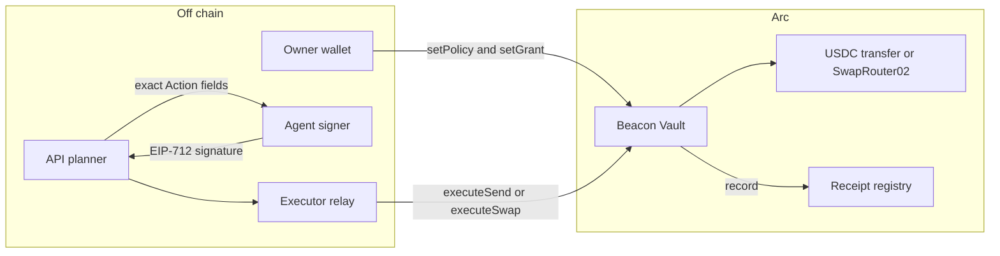
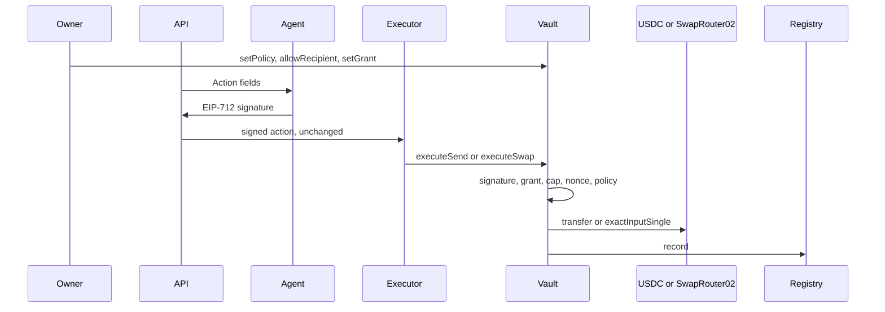
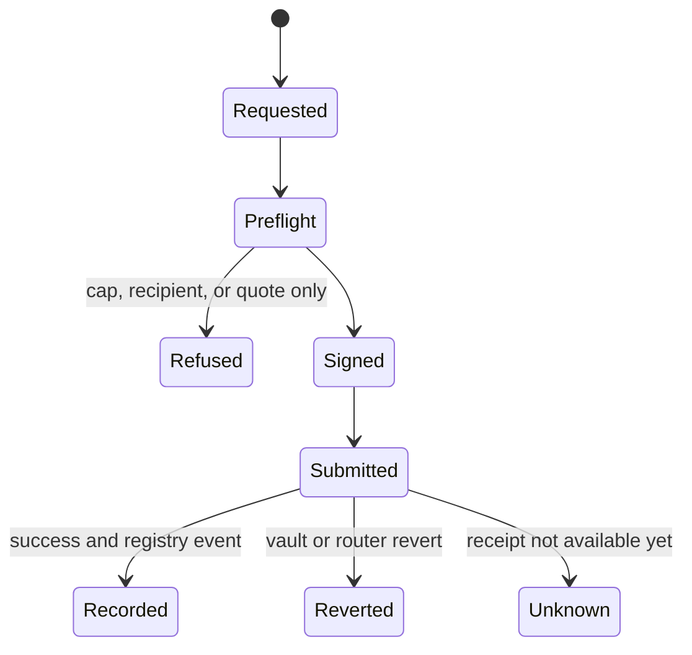

# Beacon Arc

**Give AI agents a budget, not a blank cheque.**

Policy-bounded USDC sends and swaps, enforced by a Vault on Arc and independently verifiable on-chain.

| | |
|---|---|
| Network | Arc Mainnet, chain ID `5042` |
| Product | [beacon-arc-one.vercel.app](https://beacon-arc-one.vercel.app) |
| API | [beacon-arc-api.onrender.com](https://beacon-arc-api.onrender.com) |
| Repository | [github.com/goat-dev8/beacon-arc](https://github.com/goat-dev8/beacon-arc) |
| Active vault | [`0x8901AAa87035b80c70B1636697DaE899Ef67c6fe`](https://explorer.arc.io/address/0x8901AAa87035b80c70B1636697DaE899Ef67c6fe) |
| Code these proofs describe | API `466f44e`. Site `6a9cfda` on the Vercel alias above. Contracts have not been replaced since the API release. |

Beacon lets an AI agent execute policy-bounded financial actions while the Vault enforces the owner's limits on-chain.

The agent may propose and sign one exact action. It does not receive the treasury. The Vault checks the signature, the grant, the cap, the recipient, the nonce, and the policy version before USDC moves.

## Verify a live proof

Read at block `26001492` on 2026-10-14T23:38:49Z. No later `Recorded` event exists for the active vault. These are the canonical V2 examples. Open them without a wallet.

| Proof | Transaction | Result | Action | Receipt |
|---|---|---|---|---|
| Send | [`0xa80b79d4…53fe8`](https://explorer.arc.io/tx/0xa80b79d47e760075ac574304a565c1fcfeb98eb33e1f0e77be7fa8984a653fe8) | success, block 25858345 | 1,000 base units (0.001 USDC) to `0xCb2E45A4c3703cd9C73DF09C8b945d5295Fa3Edd` | [public receipt](https://beacon-arc-one.vercel.app/verify/0x2a67ac481adb62435ddd8f8fd080423c95d50614e143600bd2b2a63d8fd93b0f) |
| Swap | [`0x1a3e7cea…26c7f`](https://explorer.arc.io/tx/0x1a3e7cea053ea5c994e9ffd22f6962b97e4e86fbe2e860dc7f1a4175a1726c7f) | success, block 25859531 | 1,000 USDC in, 891 EURC out, output to the vault | [public receipt](https://beacon-arc-one.vercel.app/verify/0x0fa111b17b2664dfc6f7a433cdbe270e38343e5dc65a6995de430dd5b7a27968) |
| Refusal | [`0x39eb0351…6fd03`](https://explorer.arc.io/tx/0x39eb0351531f57b4c8167bc508d066a3d48fa297cdc79eacf1c63fa21756fd03) | reverted, block 25859160 | no `Recorded` event and no USDC moved | none. A revert is not a receipt. |
| Larger swap | [`0xab5c6933…e7d8d`](https://explorer.arc.io/tx/0xab5c69330806929814c2fb059a7d33a6d50b46751dde3f3c53e413aeda2e7d8d) | success, block 25818567 | 5,000 USDC in, 4,463 EURC out, same vault | [public receipt](https://beacon-arc-one.vercel.app/verify/0x5b2dbbcd2617f66e517976eb53d9e475c9c3bd9dd9b1aa62469ababd2c4a85ed) |

The first three rows are the newest send, the newest swap, and a real reverted call on the active vault. The fourth row is the larger successful swap on that same vault. It is historical proof, not a second product.

**Recorded input volume, V1 and V2 together:** 30,000 base units = **0.030 USDC** across **8** successful `Recorded` events, plus **3** reverted transactions. That sum is not a balance and not "total assets."

**Active vault holdings at the same read:** 0.01 USDC and 0.006245 EURC. Nonce `6`. Not paused. Grant 1 active, scopes `7` (send + swap + bridge bits), expiry `2026-11-12T20:30:14Z`.

USDC on Arc is both the native gas token (18 decimals) and the ERC-20 at `0x3600000000000000000000000000000000000000` (6 decimals). Those are two views of one token. Do not add them.

## Contracts

V2 is the active product. V1 is the historical send-only deployment. It is immutable and still readable. Sourcify reports `exact_match` for creation and runtime on all six. That is source verification, not an audit, and it is not the same claim as an explorer badge.

| | Role | Address | Sourcify exact match |
|---|---|---|---|
| V2 | Vault | [`0x8901AAa87035b80c70B1636697DaE899Ef67c6fe`](https://explorer.arc.io/address/0x8901AAa87035b80c70B1636697DaE899Ef67c6fe) | [record](https://repo.sourcify.dev/5042/0x8901AAa87035b80c70B1636697DaE899Ef67c6fe) · 2026-10-13 |
| V2 | Factory | [`0xa7c95a58b499ed4dc607e6e7030cece2b00fab6e`](https://explorer.arc.io/address/0xa7c95a58b499ed4dc607e6e7030cece2b00fab6e) | [record](https://repo.sourcify.dev/5042/0xa7c95a58b499ed4dc607e6e7030cece2b00fab6e) · 2026-10-13 |
| V2 | Receipt registry | [`0xcecb08b2cdacaf231b1838f20f932ad265fa2583`](https://explorer.arc.io/address/0xcecb08b2cdacaf231b1838f20f932ad265fa2583) | [record](https://repo.sourcify.dev/5042/0xcecb08b2cdacaf231b1838f20f932ad265fa2583) · 2026-10-13 |
| V1 | Vault | [`0x71Ef5450F5eE6E8A888c1E7b7f2e89bCCd4fFAB6`](https://explorer.arc.io/address/0x71Ef5450F5eE6E8A888c1E7b7f2e89bCCd4fFAB6) | [record](https://repo.sourcify.dev/5042/0x71Ef5450F5eE6E8A888c1E7b7f2e89bCCd4fFAB6) · 2026-10-08 |
| V1 | Factory | [`0x3db8750EE3a397b5A8A4e1842Bfb69f511342C6b`](https://explorer.arc.io/address/0x3db8750EE3a397b5A8A4e1842Bfb69f511342C6b) | [record](https://repo.sourcify.dev/5042/0x3db8750EE3a397b5A8A4e1842Bfb69f511342C6b) · 2026-10-08 |
| V1 | Receipt registry | [`0xB4483128Bf95aa63621cB9EcA7f5d22a0d546b6C`](https://explorer.arc.io/address/0xB4483128Bf95aa63621cB9EcA7f5d22a0d546b6C) | [record](https://repo.sourcify.dev/5042/0xB4483128Bf95aa63621cB9EcA7f5d22a0d546b6C) · 2026-10-08 |

## How an action is enforced

The owner wallet calls the Vault directly.

- `setPolicy` sets `maxPerTx`, `windowLimit`, and `windowSeconds`, then increments `policyVersion`. An old signature fails `PolicyMismatch`.
- `allowRecipient` / `blockRecipient` decide who may receive a send.
- `setGrant` names the agent, a grant cap, an expiry, and scope bits. `revokeGrant` clears `active`. Scope bits are `1` send, `2` swap, `4` bridge.
- The agent signs an EIP-712 `Action`. Domain name `Beacon`, version `2`, chain ID `5042`, verifying contract = this vault. Signed fields include grant, agent, class, token, recipient, amount, `tokenOut`, `amountOutMin`, `quoteHash`, destination domain, nonce, deadline, and policy version.
- The API holds the delegated agent key and asks it to sign. The owner's key is not on the server. The server also holds the executor key, which can only relay.
- `executeSend` and `executeSwap` revert `NotExecutor` unless `msg.sender` is the executor. Changing any signed field makes `hashAction` disagree with the signature (`BadSignature`).
- Caps: amount must be non-zero and within both the policy `maxPerTx` and the grant cap, or the call reverts `OverCap` before the nonce advances. The rolling window reverts `OverWindow`.
- Sends require an allowlisted recipient that is not blocked. Swaps require `recipient == vault`, `tokenOut` allowlisted (EURC), and the pinned router.
- The registry's `record` writes the action hash, vault, agent, recipient, amount, and nonce. Anyone can recompute the hash from the public ABI and the transaction.

`quoteHash` is inside the signed struct, so editing it breaks the signature. The swap path does not compare it to an on-chain quote. The router enforces the signed `amountOutMin`.

### Send and swap

`executeSend` (`CLASS_SEND = 1`) transfers USDC with the vault's own `transfer`. Token out must be the zero address. Destination domain must be 0.

`executeSwap` (`CLASS_SWAP = 2`) approves only the input amount to SwapRouter02 `0x53BF6B0684Ec7eF91e1387Da3D1a1769bC5A6F77` and calls `exactInputSingle`. Fee is pinned at `500`. The router recipient is `address(this)`, not the field an executor might wish it were. Output stays in the vault. The pool the product quotes is `0x6fd5F2fb831940DcD61A98c5B3aCB7D8C6f3bFc1`. There is no multicall and no alternate router entrypoint in the vault source.

A quote from `GET /v1/quote/swap` is not a swap. The response sets `executable: false` for that reason. The swap receipts above are the executed trades.

### What the chain does, and what the server does

| Component | What it can do |
|---|---|
| Owner wallet | Set policy, recipients, grant, pause, executor, and withdraw. The owner key is not stored by the API. |
| Agent signer | Sign an `Action` inside its grant. The API currently holds this delegated key. |
| Executor | Submit `executeSend` / `executeSwap` unchanged. It cannot set policy or pass the signature check with edited fields. The API holds this key too. |
| API | Prepare the action, obtain the agent signature, relay through the executor, and report the chain receipt. A successful HTTP response is not settlement. |
| Vault | The enforcement boundary: signature, grant, scope, expiry, cap, window, recipient, nonce, deadline, policy version, and the pinned swap. |
| Receipt registry | Store the action evidence the public `/verify` page reads. |

A compromised server can sign and relay until the owner revokes the grant, pauses the vault, or changes the executor. That is narrower than handing the owner key to the agent. It is not a claim that the server has no keys.

This repository has no formal security audit.

## Architecture



The owner writes policy in a transaction the API does not sign. The API can assemble an action. Only the vault can let it settle.



If the executor alters a signed field, `BadSignature` reverts and the registry is not written. Final status is the transaction receipt.



A swap quote stops in `Refused` until an owner-confirmed `executeSwap` is submitted. A source-chain burn is not a completed bridge.

## Why Arc

Arc settles USDC natively, and the same asset is the ERC-20 the vault transfers, with 6 decimals. Beacon uses that for transaction-level limits: each send and swap is a specific amount, recipient, and nonce, checked in the contract that holds the funds.

The live swap is Uniswap v3 USDC/EURC on Arc, fee tier 500, through the router address pinned in `BeaconUsdcVaultV2`. EURC is `0xbEf5f6d51CB62b58e6A8f77868681825C6fe21c1`.

## Tests you can run yourself

Counts are separate. The 4 production HTTP checks sit inside the 74. They are not a 78. Unit, Foundry, typecheck, guard, and the web build were run on 2026-10-14 against the API release `466f44e`, then the unit suite was run again after the landing copy change. Playwright was run after the site commit below.

| Suite | Command | Result |
|---|---|---|
| Unit, API, live RPC, production HTTP | `npm test` | 74 passed, 0 failed |
| Production HTTP only | included in `npm test` via `apps/api/src/production.test.mjs` | 4 passed, inside the 74 |
| Foundry | `forge test` in `packages/contracts` | 42 passed, 0 failed (Foundry 1.8.5) |
| Typecheck | `npx tsc --noEmit -p apps/web/tsconfig.app.json` | clean |
| Guard | `npm run guard` | clean |
| Production web build | `npm run build --workspace=@beacon/web` | succeeded |
| Playwright | `npm run e2e` | 11 passed on 2026-10-15 against the production alias, after site commit `6a9cfda`. No wallet signature. GitHub Actions on that commit passed unit, Forge, and e2e. |
| Read-only chain | `eth_call` / `eth_getTransactionReceipt` on `https://rpc.mainnet.arc.io` | vault, balances, and the four receipts above |

Foundry uses local mocks. A passing bridge test is not a live CCTP transfer. `npm test` reads public Arc and the public API. It does not broadcast.

Node 22 is what CI uses. This run used Node v24.12.0. Package manager is npm workspaces.

## Local setup

```bash
git clone https://github.com/goat-dev8/beacon-arc.git
cd beacon-arc
npm install
```

Copy `.env.example` to `.env`. Leave `DEPLOYER_PRIVATE_KEY`, `EXECUTOR_PRIVATE_KEY`, and `AGENT_PRIVATE_KEY` empty. The tests above do not need them.

```bash
npm test
npx tsc --noEmit -p apps/web/tsconfig.app.json
npm run guard
npm run build --workspace=@beacon/web
cd packages/contracts && forge test
```

Frontend only:

```bash
npm run dev --workspace=@beacon/web
```

API process (`npm start`) loads `.env` and will relay only when an executor key is present. Do not put a mainnet operator key in a review checkout. Nothing in the test commands above sends a mainnet transaction.

Public reads, no key:

```bash
curl https://beacon-arc-api.onrender.com/health
curl "https://beacon-arc-api.onrender.com/v1/quote/swap?amount=1000"
```

The quote names the v3 venue and returns `executable: false`. That is intentional.

## Three-minute review

No wallet and no new transaction.

1. Open [the product](https://beacon-arc-one.vercel.app).
2. The vault enforces a signed action. The agent does not hold the treasury.
3. Open the [active vault](https://explorer.arc.io/address/0x8901AAa87035b80c70B1636697DaE899Ef67c6fe).
4. Open its [Sourcify exact match](https://repo.sourcify.dev/5042/0x8901AAa87035b80c70B1636697DaE899Ef67c6fe).
5. Open the [send](https://explorer.arc.io/tx/0xa80b79d47e760075ac574304a565c1fcfeb98eb33e1f0e77be7fa8984a653fe8).
6. Open the [swap](https://explorer.arc.io/tx/0x1a3e7cea053ea5c994e9ffd22f6962b97e4e86fbe2e860dc7f1a4175a1726c7f).
7. Open the [reverted call](https://explorer.arc.io/tx/0x39eb0351531f57b4c8167bc508d066a3d48fa297cdc79eacf1c63fa21756fd03).
8. Open the [send receipt](https://beacon-arc-one.vercel.app/verify/0x2a67ac481adb62435ddd8f8fd080423c95d50614e143600bd2b2a63d8fd93b0f).
9. Open [API health](https://beacon-arc-api.onrender.com/health) and the [quote](https://beacon-arc-api.onrender.com/v1/quote/swap?amount=1000). The quote is not a trade.
10. Clone the repo and run `npm test`.

Connecting a wallet is a separate owner flow. The steps above do not perform it.

## Scope

Live on the active vault: policy-bounded USDC sends, and USDC to EURC swaps through the pinned Uniswap v3 path, with public receipts.

Present in source, not a completed product path:

- `executeBridge` targets Circle CCTP TokenMessenger `0x28b5a0e9C621a5BadaA536219b3a228C8168cf5d`. Contract-initiated USDC burns on Arc revert, so Beacon does not report a completed bridge. An EOA burn on the same messenger is a different caller and is not this vault.
- CCTP-X for EURC is documented by Circle and is not called.
- Privacy transfers, a post-quantum wallet, x402 settlement, and ERC-8004 registration are not executable here.

## References

- [Arc documentation](https://docs.arc.io)
- [Arc RPC](https://rpc.mainnet.arc.io) and [Arc explorer](https://explorer.arc.io)
- [Uniswap v3 single swap](https://docs.uniswap.org/contracts/v3/guides/swaps/single-swaps)
- [Circle CCTP](https://developers.circle.com/cctp) for the bridge boundary above, not as a live Beacon transfer
- [Active vault Sourcify record](https://repo.sourcify.dev/5042/0x8901AAa87035b80c70B1636697DaE899Ef67c6fe)
- [Product](https://beacon-arc-one.vercel.app) · [API health](https://beacon-arc-api.onrender.com/health) · [repository](https://github.com/goat-dev8/beacon-arc)
